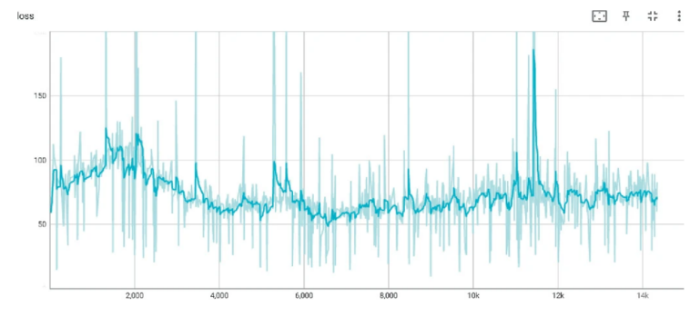
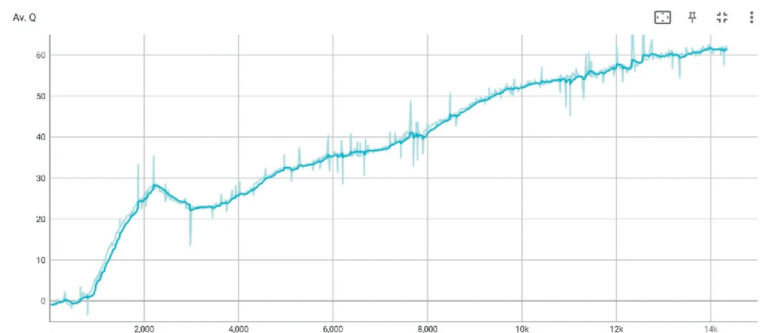
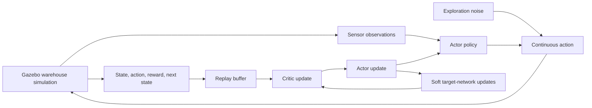

<div align="center">

# Autonomous Warehouse Navigation

### Deep reinforcement learning for goal-directed robot navigation.

**DDPG · Gazebo · Report-based project showcase**

[Results](#reported-results) · [System design](#system-design) · [Learning approach](#learning-approach) · [Archive status](#archive-status)

</div>

A research project report exploring how a warehouse robot could learn to reach goals while avoiding obstacles using **Deep Deterministic Policy Gradient (DDPG)**. The described setup combines a Gazebo warehouse simulation with continuous control, sensor observations, and an actor–critic learning loop.

This repository presents the method and historical results preserved in the project draft. It contains documentation and report figures; the matching DDPG navigation implementation was not recovered. Additional semester material supplies a separately identified third-party robot simulation base.

## The navigation problem

Warehouse navigation requires a robot to move through aisles, shelving, and obstacles toward a target. The report studies a learned control policy that balances **goal progress** against **collision avoidance**.

The proposed simulation includes LIDAR, RGB-D cameras, and ultrasonic sensing. Sensor preprocessing, observation dimensions, robot model, and control bounds are not specified sufficiently in the preserved material to reproduce the environment.

## Reported results

### Critic training loss



*Original report figure. The smoothed curve falls after the early training period and later fluctuates. Visible spikes remain; this plot alone does not establish convergence or navigation success.*

### Average Q-value



*Original report figure. The plotted average Q-value trends upward across the displayed training steps. Q-value growth is a learning diagnostic, not a measured goal-completion rate.*

### Comparison recorded in the draft

| Metric | Proposed method, as reported | Comparison method, as reported |
| --- | ---: | ---: |
| Efficiency | 85% | 78% |
| Collision rate | 5% | 12% |
| Average reward | 150 | 120 |

**Evidence boundary:** these values are transcribed from the draft's comparison table. The archive does not include raw logs, evaluation episodes, metric definitions, seed counts, or a runnable comparison baseline. They are historical reported figures, not independently reproduced benchmark results. The images above are report extracts, not newly generated training runs.

## System design



*Reconstruction of the learning workflow described in the report; it is not an executable simulation diagram.*

## Learning approach

The report uses an off-policy actor–critic design:

- **Actor:** maps observations to continuous control actions.
- **Critic:** estimates the value of state–action pairs.
- **Replay buffer:** stores transitions and supplies sampled minibatches.
- **Exploration:** adds noise to the actor's action during training.
- **Target networks:** receive soft updates to stabilize learning targets.

### Reward described in the report

| Event | Reward |
| --- | ---: |
| Goal reached | +100 |
| Collision | −100 |
| Otherwise | −d, where d is distance to the goal |

This encourages goal-reaching and penalizes collisions and distance from the target. The report does not provide enough environment detail to assess reward scaling, termination rules, or behavior across different warehouse layouts.

## What the project explored

- Applying continuous-control reinforcement learning to warehouse navigation.
- Combining exploration, experience replay, and target networks.
- Using loss and Q-value plots to inspect training behavior.
- Comparing navigation efficiency, collision rate, and accumulated reward.

## Archive status

This is a historical, report-based showcase and is not actively maintained. There is no installation or run command because the matching DDPG source, Gazebo worlds, robot description, checkpoints, and navigation logs were not found.

The supplied folder also contained neural style-transfer scripts and images. Those belong to a different project and are intentionally excluded from this navigation repository.

To make this project reproducible, recover the simulation environment, observation/action specifications, actor and critic implementations, training configuration, checkpoints, and evaluation logs. The original draft also mixes a max-over-actions Bellman equation with a target-actor update in its pseudocode; a recovered implementation should resolve that ambiguity before reproduction.

## Repository contents

```text
README.md                     Project overview and reported results
docs/
  results/
    critic-loss.png           Historical critic-loss figure
    average-q-value.png       Historical Q-value figure
  SOURCE_NOTES.md             Evidence provenance and scope
```

## Source material

The showcase is based on the three-page project draft titled **Autonomous Warehouse Navigation Using Deep Reinforcement Learning**. Figures were extracted from its results page. The draft itself is not included here because it contains personal identifiers; this presentation excludes team names, student IDs, and group identifiers.

## Additional semester material

See the [recovered simulation scene, method notes, and robot-base package](docs/semester-material/README.md). The upstream robot package is preserved separately from the unavailable DDPG controller.
