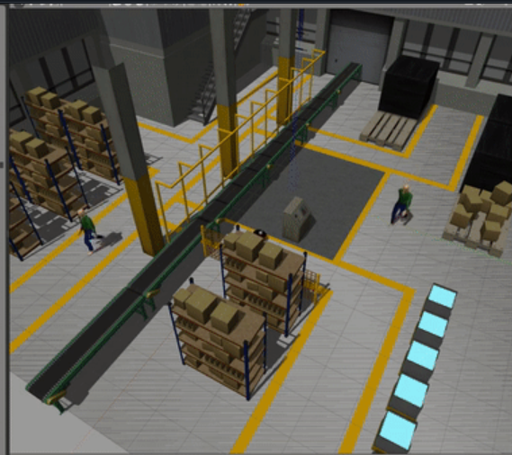

# Additional warehouse-navigation material

The semester collection adds a navigation report and a recovered BCR robot simulation package to the earlier report-based archive.

## Simulation scene from the report

Historical report illustration; no simulation was run to prepare this archive.

## Navigation method described

The report describes selecting candidate waypoints from 2D laser scans, filtering visited or unsuitable points, and scoring candidates for progress toward the global goal. A DDPG actor then outputs linear and angular velocity commands; the critic estimates action values. The described reward favors goal arrival and forward progress while penalizing collisions and sharp turns.

The document includes critic-loss and Q-value figures consistent with the report-based showcase. It does not supply a matching trained policy, evaluation logs, or a complete DDPG training implementation.

## Recovered simulation package

[robot-base-source.zip](robot-base-source.zip) preserves the BCR robot package, including launch files, robot descriptions, meshes, warehouse worlds, the original README, and its license. The [archive index](SOURCE_INDEX.md) lists its contents.

This is third-party simulation support from **Black Coffee Robotics**, identified by the retained package metadata and README ([upstream BCR robot project](https://github.com/blackcoffeerobotics/bcr_bot)). It is not presented as an original robot model or as the missing learned controller. Upstream attribution and licensing are retained.

The recovered README documents ROS 2 Humble variants with Gazebo Classic or Fortress, plus historical ROS 1 instructions. Follow the archived package README for its intended environment. Compatibility and integration with the reported DDPG workflow were not tested during publication.

Raw reports containing team identifiers and unrelated reference papers are excluded from this upload.
